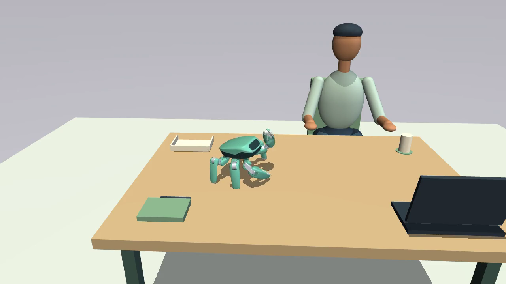

# Mizu on Jumper, with ClawMetry

A calm desk companion demo, with a clear task and a record of what it actually did.

Built-in Jumper support is available in ClawMetry 0.12.930 and later.
The normal package includes the observer and Physical AI history.



**Jumper observation, task governance and Physical AI history belong to ordinary
ClawMetry OSS.** This repository contains the Mizu example: simulator host,
verified source/asset provenance, authored desk scene, companion skills, browser
playground and review film. It ships no second ClawMetry extension or dashboard.

```sh
pip install "clawmetry>=0.12.930"
clawmetry
```

That is the shared ClawMetry installation for Jumper and supported digital-agent
runtimes. Robot simulation/training libraries are needed only by a robot host or
this optional demo; the dashboard does not install or run them.

Mizu began as the user-provided LeRobot healthy desktop prototype:
a reminder to stretch, water brought within reach, and a little tidying after
work. This experiment brings the idea to KingKong Robotics' Jumper. It is a
**simulation demo**. It does not establish hardware safety or autonomous glass delivery.

## Use the built-in observer

An application producing Jumper measurements uses the API in the main package:

```python
from clawmetry.physical_ai import DeskMonitor, JumperObserver

with JumperObserver(
    "desk-companion", environment="simulation",
    monitor=DeskMonitor(),
) as observer:
    # Call from the real robot/simulator telemetry callback.
    observer.observe(measured_frame, now_s=measured_frame["time_s"])
```

ClawMetry discovers the shared typed journal, ingests it through its normal
single-writer daemon, and exposes persisted Physical AI history in the main
dashboard. Requests, decisions, native-controller receipts and incidents remain
separate facts. The observer does not actuate a robot. An application must
explicitly enable a qualified simulator skill before forwarding any request.
Hardware command delivery is unavailable through this demo.

## What works in the recorded run

- The official Jumper `play --app` simulator and MP4 recorder run a finite desk
  scene with a seated static human proxy and a calm sage robot color treatment.
- Real native-controller wave and bow complete and return to the standing policy.
- An unrelated jump request is denied before controller delivery.
- The conservative full collision footprint remains inside the table in this episode.
- Built-in ClawMetry APIs record observations, permissions and controller receipts
  to the shared journal. Optional demo DuckDB sidecars support film reproduction.
- The built-in monitor identifies measured edge approach/crossing, base lift,
  excessive tilt and unavailable observations. Actual production notifications use
  ClawMetry's shared incident channels and delivery receipts.

The original seed-42 run measured **7,000 control steps, no resets and 0.310 m
minimum conservative tabletop clearance**. This is one episode, not a physical
containment guarantee. [Run details](docs/official-replay.md).

Phone delivery is not configured in the film. A local capture receipt is not a
delivered phone alert. Missing observations produce unknown outcomes. Rejecting
one input does not prove protection from every command path.

## Reproduce the optional Mizu demo

Python 3.10 to 3.13 is required by the pinned simulator. Use an isolated environment.

```sh
git clone https://github.com/vivekchand/clawmetry-jumper.git
cd clawmetry-jumper
python3.12 -m venv .venv
.venv/bin/python -m pip install -e '.[sim,dev]'
git clone https://github.com/KingKongRobotics/jumper.git ../jumper
git -C ../jumper checkout 78966f45de6f2b6de3f7cea017f32a39f8b993e6
.venv/bin/clawmetry-jumper record --upstream ../jumper --output artifacts/my-first-run
.venv/bin/clawmetry
```

The runner observes by default. Add `--enable-simulator-controls` to request the
qualified wave and bow through the built-in task gate. Use a new output folder
for each recording. The normal observer journal directory makes the run visible
to the standard ClawMetry collector; `--journal-dir` is an explicit override for
isolated tests. There is no separate `serve` command or external extension install.

The editable demo installs the ordinary published ClawMetry package from PyPI.
It does not need a Git candidate or a separate observer package. To run its checks:

```sh
.venv/bin/python -m pytest -q
```

For the official simulator, including the desk and seated person, follow
[scene preparation](docs/scene-build.md) and [official replay](docs/official-replay.md).
Neither playback path claims the full upstream training/device toolchain is ready.

## Companion skills and story

[Skills](skills/README.md) define purposeful tasks and qualification requirements.
The demo qualifies wave and bow. Table travel, picking up a vessel, transporting
water and tidying need separately validated motion/manipulation skills. The
[roadmap](docs/task-roadmap.md) records the actual upstream grasp experiments.
No cup is welded to a claw to manufacture a success.

[Storyboard](docs/storyboard.md) ·
[Original Mizu post](https://www.linkedin.com/feed/update/urn:li:activity:7513599170314928130/) ·
[ClawMetry OSS](https://github.com/vivekchand/clawmetry) ·
[Physical AI](https://clawmetry.com/physical-ai)

Jumper model, policies and controller: [KingKong Robotics](https://github.com/KingKongRobotics/jumper).
Scene tools: [Jumper Design](https://github.com/KingKongRobotics/jumper-design).
Simulation: [MuJoCo](https://github.com/google-deepmind/mujoco).

Apache-2.0 for this demo. See [LICENSE](LICENSE) and [NOTICE](NOTICE).
Third-party runtime and asset licenses remain their own.
